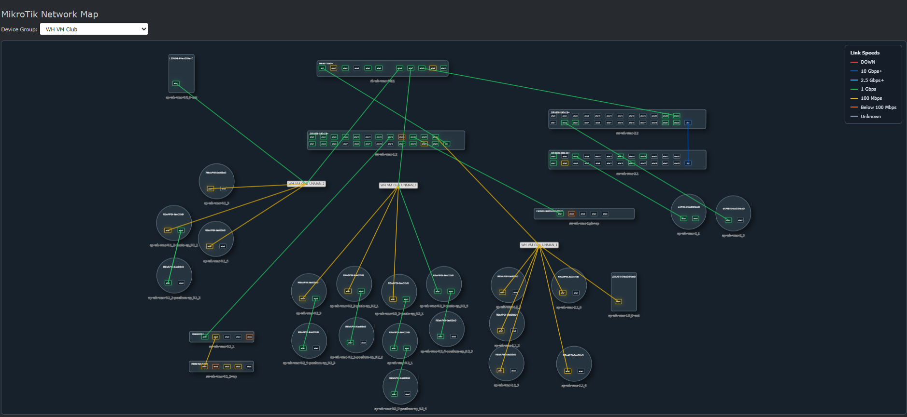
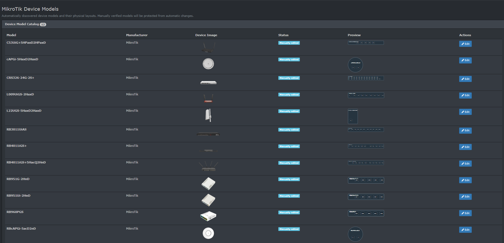

# MikroTik Integration for LibreNMS

An open-source integration for **LibreNMS** focused on discovering, monitoring, and visualizing **MikroTik RouterOS** networks.

The project extends LibreNMS with MikroTik-oriented topology and discovery workflows while keeping LibreNMS as the system of record for devices and monitoring data.

> **Project status:** Early development (`dev-main`). This is not yet a tagged stable release. Review the configuration and test in your environment before production use.

## Overview

MikroTik networks can contain complex physical connections, bridges, VLANs, wireless links, and routed segments. Standard monitoring views do not always make the underlying topology obvious. This plugin aims to provide a clearer, device-group-oriented view using LibreNMS data and MikroTik-specific information where needed.

## Features and project direction

The project is designed around these capabilities:

- **Network topology:** Visualize MikroTik devices and their relationships in LibreNMS.
- **Neighbor discovery:** Use LLDP, CDP, and MikroTik Neighbor Discovery Protocol (MNDP) information where available.
- **RouterOS API enrichment:** Supplement monitoring information when SNMP alone is insufficient.
- **LibreNMS device groups:** Organize topology views around existing groups.
- **Physical-link visibility:** Distinguish meaningful physical connections from virtual or logical interfaces.
- **Discovery controls:** Support rules for handling newly discovered devices and filtering unwanted interfaces, including VLAN interfaces.
- **Device details:** Provide a quick device view with identity, IP address, availability, resource information, uptime, and active alerts, with a link to the LibreNMS device page.
- **Status-aware visualization:** Make unavailable devices and devices with active alerts easy to distinguish.

**Implementation note:** This list describes the project's functional scope, not a guarantee that every item is complete in the current development branch. Check the code and release notes before relying on an individual feature.

## Screenshots

### Network topology map

Explore the topology of a LibreNMS device group, including MikroTik device port layouts and link-speed indicators.



### Device model catalog

Review detected MikroTik hardware models, device images, port-layout previews, and manually edited model entries.



> **Privacy note:** Screenshots are from a configured environment. Before publishing screenshots from your own network, remove identifying hostnames, IP addresses, and sensitive network details.

## Requirements

- An existing, working LibreNMS installation with plugin support.
- PHP and Composer versions compatible with that LibreNMS installation.
- Git, for installing this development package from its source repository.
- Network reachability and appropriate permissions for any MikroTik devices you choose to integrate.
- A LibreNMS administrator account to enable and configure the plugin.

Follow the [official LibreNMS documentation](https://docs.librenms.org/) for the platform's supported versions and installation requirements.

## Installation

> The repository currently uses the development branch `main` (`dev-main`). Install and test it in a non-production LibreNMS instance first. The commands below assume a conventional installation at `/opt/librenms` and a `librenms` service account.

### 1. Register the Composer source repository

Run Composer as the LibreNMS service account:

```bash
cd /opt/librenms
sudo -u librenms -H php composer.phar config --global repositories.mikrotik git \
  https://github.com/DuMbh3aD/librenms-mikrotik.git
```

If your LibreNMS installation uses a different Composer executable, adapt the command accordingly.

### 2. Register the plugin with LibreNMS

LibreNMS supports a `composer.plugins.json` file to retain user-installed Composer plugins across its update process. Add the following package requirement, preserving any existing entries:

```json
{
  "require": {
    "librenms/plugin-mikrotik": "@dev"
  }
}
```

**Do not overwrite** an existing `composer.plugins.json` containing other plugins; merge this entry into its `require` object.

### 3. Install the package

```bash
cd /opt/librenms
sudo -u librenms -H php composer.phar require \
  'librenms/plugin-mikrotik:@dev' \
  --no-interaction
```

The package should be installed under:

```text
/opt/librenms/vendor/librenms/plugin-mikrotik
```

The plugin should be managed by Composer, **not** by a manually maintained symlink to a separate source directory.

### 4. Enable and configure the plugin

Enable the MikroTik plugin using LibreNMS's plugin-management interface or the applicable `lnms plugin:enable` command for your installation. Then review the plugin's settings in LibreNMS.

Only enable RouterOS API access on devices where it is needed, and use a dedicated account with the minimum permissions required by the deployed features.

> **Configuration details:** Exact setting names, API permission requirements, and supported discovery controls should be verified against the current implementation before being documented as stable interfaces.

## Updates

LibreNMS's normal update process reads `composer.plugins.json`, registers the listed packages, and runs Composer installation. Keeping the package declared there is important because LibreNMS may restore its core `composer.json` and `composer.lock` during updates.

The package is currently on `dev-main`; its contents may change without a tagged release. Back up the installation and database before upgrading, and review upstream changes.

Do not modify files directly under `vendor/librenms/plugin-mikrotik`: Composer can replace those files during installation or updates.

## Verification and troubleshooting

From your LibreNMS installation directory:

```bash
# Confirm that the package is installed from Git
sudo -u librenms git -C vendor/librenms/plugin-mikrotik rev-parse --short HEAD

# Check whether MikroTik routes are registered
sudo -u librenms -H php artisan route:list | grep -i mikrotik

# Inspect LibreNMS application logs
sudo -u librenms tail -n 100 logs/librenms.log
```

If the plugin does not appear, check that Composer installed the package, the plugin is enabled, the installed code is compatible with your LibreNMS version, and application logs do not show PHP or Laravel errors.

If topology data is incomplete, first verify LibreNMS device discovery and SNMP data, then check the availability and permissions of the additional MikroTik discovery sources used in your configuration.

## Security

- Prefer management networks or VPN connectivity for monitoring traffic and RouterOS API access.
- Restrict RouterOS API access by source IP and firewall policy.
- Use a dedicated, least-privilege RouterOS account; avoid reusing full administrator credentials.
- Never commit API credentials, access tokens, private keys, or production configuration exports to Git.
- Review discovered devices and any automatic device-addition rules before enabling broad discovery.
- Keep LibreNMS, RouterOS, and the plugin updated, and test changes before deploying them to production.

## Development and contributions

Issues, bug reports, and contributions are welcome. When reporting a problem, include:

- LibreNMS and PHP versions;
- plugin commit or release;
- RouterOS version and relevant device type;
- steps to reproduce and expected versus actual behavior;
- sanitized logs, without passwords, tokens, public IPs, or sensitive topology information.

For proposed changes, keep LibreNMS compatibility, security, and maintainability in mind. Please avoid adding environment-specific paths, credentials, or organization-specific branding.

## Roadmap

Areas of ongoing work include neighbor discovery quality, physical-link accuracy, device-group topology, configurable discovery rules, API-assisted enrichment, and clearer filtering of logical interfaces. The roadmap is directional; it does not imply a delivery schedule.

## License

Licensed under the **GNU General Public License v3.0**. See [LICENSE](LICENSE) for the complete license text.

## Links

- [Source code and issues](https://github.com/DuMbh3aD/librenms-mikrotik)
- [LibreNMS documentation](https://docs.librenms.org/)
- [MikroTik RouterOS documentation](https://help.mikrotik.com/docs/)
